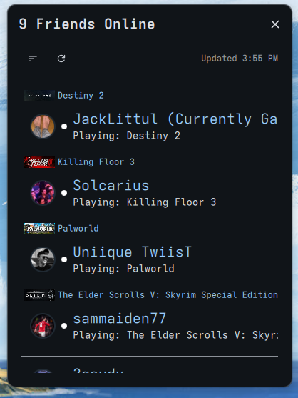
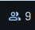
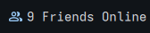

# Steam Friends
A dankbar widget to show the number of friends online and a popout to tell you who!

## Screenshot

 

## Features
- Sort by status or by user name, with an icon-only sort/refresh toolbar (your sort choice is remembered)
- Shows which friends are online and their status (Online, Away, Busy, Snooze, Looking to Trade, Looking to Play), each with its own colored status dot
- If in a game, shows which game, with friends grouped by game when sorted by status
- Game group headers show the game's Steam capsule art and are clickable, opening that game's store page
- Friend avatars shown next to each entry, with a hover highlight on each friend card
- Click a friend to open a Steam chat with them, right-click to open their Steam profile
- Search box to filter friends by name or game
- Hover the bar widget for a quick summary (e.g. "2 playing · 3 online")
- Optional desktop notifications when a friend comes online or starts a game
- Configurable refresh interval (1 to 15 minutes), with a spinning refresh icon while loading
- "Last updated" timestamp shown in the popout
- Optional toggle to show/hide the "Friends Online" text in the bar, leaving just the icon and count
- Optional toggle to hide the bar widget entirely while no friends are online
- Clear error banner shown in the popout if a fetch fails (bad API key, network issue, etc.) instead of silently showing nothing

## Requirements
- `curl` and `jq`
- `notify-send` (from libnotify), only needed for notifications

## Installation
Very easy, just do one of the following:
- Go to [danklinux.com/plugins](https://danklinux.com/plugins) and search for it, then click 'Install'
- Open DMS settings > plugins > browse > search > Install
- On the GitHub page > Code > Download Zip > extract it to: ~/.config/DankMaterialShell/plugins

## Setup
You're going to need two things for this to work:
- Steam API key - You can get your own Steam API key from here: [Steam API](https://steamcommunity.com/dev/apikey)
- Steam ID64 - the 17-digit number for your account, which you can find here: [Steam ID](https://steamid.io/)

Then open DMS settings > plugins and enter both into the Steam Friends plugin settings. The list refreshes automatically about a second after you finish typing.

## Settings
| Setting | Default | What it does |
| --- | --- | --- |
| API Key | - | Your Steam Web API key |
| Steam ID | - | Your Steam ID64 |
| Show "Friends Online" text | On | Shows "X Friends Online" in the bar, or just the count when off |
| Hide when no friends are online | Off | Hides the bar widget while nobody is online (it still shows if not set up or a fetch fails) |
| Notify when a friend comes online | Off | Desktop notification when a friend signs in |
| Notify when a friend starts a game | Off | Desktop notification when a friend starts playing something |
| Refresh interval | 5 minutes | How often to check: 1, 2, 5, 10 or 15 minutes |

## Changelog
### 1.3.0
**New**
- Search box in the popout to filter friends by name or game
- Optional desktop notifications when a friend comes online or starts a game (several at once are combined into one notification)
- Hover tooltip on the bar widget with a quick summary, e.g. "2 playing · 3 online"
- Option to hide the bar widget while no friends are online
- Right-click a friend to open their Steam profile
- Refresh interval setting (1 to 15 minutes)
- Refresh icon spins while friends are loading
- Sort order is remembered between restarts
- Friend cards use your DMS card colour and highlight on hover
- Setup prompt shown in the popout when the API key or Steam ID is missing

**Fixes**
- Settings changes (API key, Steam ID, toggles) now apply straight away instead of needing a restart
- The API key no longer appears in the process list while fetching
- Friends are fetched in batches of 100, so accounts with over 100 friends work
- Old friends and counts are cleared when a fetch fails, instead of showing stale data next to the error
- An empty friend list shows "No friends online" instead of an error
- Unexpected responses from Steam now show an error instead of failing silently
- The "1 Friend Online" label is now singular
- Sort icon name corrected, and the error message follows your theme's error colour
- Works when installed in a path containing spaces

**Changes**
- `jq` is now required (the limited fallback without it was removed)
- Removed debug logging

## Author
Created by banicans

## Links
- [DankMaterialShell](https://github.com/AvengeMedia/DankMaterialShell)
- [Steam API](https://steamcommunity.com/dev)
- [Steam ID](https://steamid.io/ )
